<div align="center">

<a href="https://cognitum.one/rupro?utm_source=github&utm_medium=readme&utm_campaign=ruflo-readme-rupro-neon"></a>

<a href="https://cognitum.one/rupro?utm_source=github&utm_medium=readme&utm_campaign=ruflo-readme-rupro-workspace"><picture><source media="(max-width: 760px)" srcset="https://raw.githubusercontent.com/ruvnet/ruflo/6f847a38ebc8594c627bd834b967fe0c238a1623/docs/assets/readme/rupro-workspace-mobile.svg"></picture></a>

<p align="center">
<a href="https://cognitum.one/rupro?utm_source=github&utm_medium=readme&utm_campaign=ruflo-readme-rupro-explore"></a>
<a href="https://cognitum.one/?utm_source=github&utm_medium=readme&utm_campaign=ruflo-readme-rupro-demo#demo=welcome"></a>
</p>

**An agent meta-harness for Claude Code and Codex.**

<!-- Try Ruflo — the 3 badges first-time visitors actually act on -->
[](https://www.npmjs.com/package/ruflo)
[](https://opensource.org/licenses/MIT)
[](https://github.com/ruvnet/ruflo)
[](https://x.com/rUv)

<p align="center">
<a href="docs/harness-origins.md"></a>
<a href="https://github.com/ruvnet/ruvnet/blob/main/data/ecosystem-running-totals.json"></a>
<br>
<a href="https://github.com/ruvnet/claude-flow"></a>
<a href="https://claude.ai/customize/plugins/id/e74b8927-3c53-4082-b0d9-fe82bf1235ce%40anthropic-plugin-directory"></a>
<a href="https://www.npmjs.com/package/@claude-flow/codex"></a>
<a href="https://chatgpt.com/plugins/plugin_asdk_app_6ab674ff53c48191bb37040c343e31f3"></a>
</p>

</div>

<a id="start-here"></a>
<a id="quick-start"></a>
<a id="get-started-in-one-command"></a>

## Run your first task

Run this in your project folder:

```bash
npx ruflo@latest init
```

Then open Claude Code in the same folder and give it a real task, for example:

```text
Use a ruflo swarm to review this repo: find the riskiest module, write tests for it, and summarise what you changed.
```

`init` adds ruflo's agents, hooks, memory and MCP server to the project, and Claude Code picks them up on its next start. Codex and other MCP clients work too: point them at `npx -y ruflo@latest mcp start`.

**Check the result.** Ask the agent to name the module it chose, show the test it added, and report the test command and result. Review the diff in your project.

<p align="center">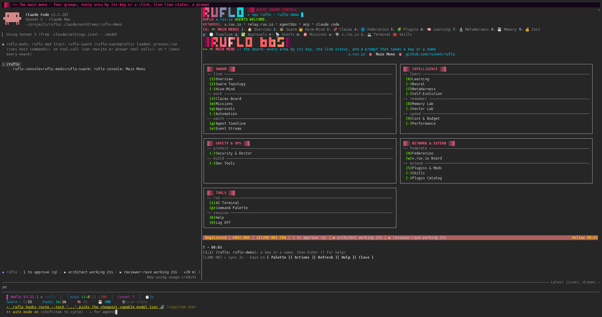</p>

[First task walkthrough](docs/ruflo-explained.md) · [Inspect a run in Mission Control](#mission-control) · [Other ways to install](#install-options)

<a id="install-options"></a>

<details>
<summary>Other ways to install</summary>

There are **two different install paths** with very different surface areas. Pick based on what you need (#1744):

| | **Claude Code Plugin** | **CLI install (`npx ruflo init`)** |
|---|---|---|
| What it gives you | Slash commands + a few skills + agent definitions per-plugin | Full Ruflo loop — 98 agents, 60+ commands, 30 skills, MCP server, hooks, daemon |
| Files in your workspace | **Zero** | `.claude/`, `.claude-flow/`, `CLAUDE.md`, helpers, settings |
| MCP server registered | Only if `ruflo-core` is installed (it ships its own `.mcp.json`) — most other plugins don't | Yes |
| Hooks installed | No | Yes |
| Best for | Try a single plugin's commands without committing to the full install | Production use — everything works as documented |

**Claude Code plugins only.** This route installs core tools, the visual console and runtime mods, with no files added to your project. It needs Claude Code **2.1.287 or later**. Run inside Claude Code:

```text
/plugin marketplace add ruvnet/ruflo
/plugin install ruflo-core@ruflo
/plugin install ruflo-console@ruflo
/plugin install ruflo-mods@ruflo
/reload-plugins
/ruflo
```

From a terminal, on Claude Code 2.1.292 or later: `claude plugin install ruflo-core@ruflo --marketplace ruvnet/ruflo`. Mods run with your account's permissions, so review their code before installing.

**Codex or another MCP client, without project setup.** Configure the **command** `npx` with the **arguments** `["-y", "ruflo@latest", "mcp", "start"]`. To set up a project interactively, run `npx ruflo@latest init wizard`.

**Plain terminal.** The console also runs on its own, without Claude Code: `npx ruflo tui`. Add `--plain` to print one frame for scripts. See the [terminal UI guide](docs/USERGUIDE.md#terminal-ui-optional).

<p align="center"></p>

`ruflo-core` registers its own MCP server. Its tools use the `mcp__plugin_ruflo-core_ruflo__` prefix.

###  CLI Install

**macOS / Linux / WSL / Git-Bash:**

```bash
# One-line install (POSIX shells only — see Windows note below)
curl -fsSL https://cdn.jsdelivr.net/gh/ruvnet/ruflo@main/scripts/install.sh | bash
```

**All platforms (including native Windows PowerShell / cmd):**

```bash
# Interactive setup wizard — runs identically on every platform
npx ruflo@latest init wizard

# Quick non-interactive init
# npx ruflo@latest init

# Or install globally
npm install -g ruflo@latest
```

> 💡 **Windows users:** the `curl ... | bash` form needs a POSIX shell (Git-Bash, WSL, MSYS). The `npx ruflo@latest init wizard` line works natively in PowerShell and cmd. If you hit an `'bash' is not recognized` error, use the `npx` line instead — both end up running the same init flow.

###  MCP Server

```bash
# Add Ruflo as an MCP server in Claude Code
claude mcp add claude-flow -- npx ruflo@latest mcp start
```

For static inspection of local applications and binaries, see the [ruRE plugin guide](plugins/ruflo-rure/README.md).

---

**Grok Build:** `npx ruflo init --grok` writes the project host surface (`.grok/`, the team bus, and the operator guide) and nothing outside the project; add `--dry-run` to preview. Setup, the `spawn_subagent` contract, the optional status row, and what to re-check when Grok updates: [the Grok operator guide](v3/@claude-flow/cli/templates/grok/docs/README.md).

</details>

## Mission Control

<p align="center"></p>

Open `/ruflo` in Claude Code to monitor agent work, inspect a run, or give Claude permission to operate the console.

If you use the console, open the agent’s log and compare its actions with the diff and test result from your first task.

| Task | What you can do |
| --- | --- |
| Monitor work | Track workflows, agents, models, token use, and cost. [Workflow demo with sample data](docs/assets/ruflo-console-workflows.svg) |
| Inspect a run | Search logs and results, triage failures, replay a run, and compare outcomes. |
| Customize the console | Preview Orbital, switch among six palettes, save a theme, or import its JSON. [38 second renderer replay](https://raw.githubusercontent.com/ruvnet/ruflo/main/docs/assets/ruflo-console-theme-compact.svg) · [Theme Studio guide](plugins/ruflo-console/README.md) |
| Control Claude’s access | Choose a permission level and approval mode in **Settings → Claude control**. Review each action in the live log. [Permission details](v3/docs/adr/ADR-444-claude-controls-the-console.md) |

### Install and open the console

Use Claude Code **2.1.287 or later**. Review mods before installing them because they run with your account’s permissions.

```text
/plugin marketplace add ruvnet/ruflo
/plugin install ruflo-console@ruflo
/plugin install ruflo-mods@ruflo
/reload-plugins
```

Open `/plugin` to check the active mods, then `/ruflo` to launch the console. For a project initialized through the CLI, run `npx ruflo init` and restart Claude Code before opening `/ruflo`.

<details>
<summary>Console mods and catalog</summary>

| Mod | Purpose |
| --- | --- |
| `ruflo-console` | Opens the console beside Claude Code. |
| `ruflo-mods` | Routes prompts and enforces policy in process. |
| `ruflo-swarm` | Adds a pane showing the swarm. |
| `ruflo-ruos` | Adds the ruOS status segment. |

Open `/ruflo market` to inspect plugins, mods, and skills. The catalog asks for confirmation before installing, enabling, disabling, or updating an item.

</details>

<a id="console-walkthrough"></a>

### Create a mission with Claude

The default is **read + ask**. Available levels are `read`, `write`, `manage`, and `full`, with `ask` or `auto` approval. Actions above the selected level are refused. Network, spending, and destructive actions require confirmation even in `auto`.

1. In **Settings → Claude control**, select **write + ask**.
2. Ask Claude, “Create a mission to add a dark mode toggle. Show me the mission and its status.”
3. Confirm the pending creation request. Check **Missions** for the goal and **Overview** for the action log. This verifies that the mission was created.
4. Select **Take back control**, then ask Claude to take another console action. The console should refuse it until you restore access.

[Watch the recorded Claude Haiku session](docs/assets/ruflo-console-claude-control.gif) to see mission creation, page navigation, a refused swarm stop, and control being taken back. The recording uses `write + auto`. Step 1 uses `ask` so you can approve creation yourself. [Recorded test findings](v3/docs/adr/ADR-444-claude-controls-the-console.md) · [Reproduction script](plugins/ruflo-console/scripts/e2e-control.sh)

<a id="what-you-get"></a>

## Choose your next capability

<table>
<tr><td width="50%"><a href="plugins/ruflo-swarm/README.md"></a></td><td width="50%"><a href="plugins/ruflo-rag-memory/README.md"></a></td></tr>
<tr><td width="50%"><a href="plugins/ruflo-intelligence/README.md"></a></td><td width="50%"><a href="plugins/ruflo-security-audit/README.md"></a></td></tr>
<tr><td width="50%"><a href="https://ruvnet.github.io/ruflo"></a></td><td width="50%"><a href="plugins/ruflo-ruvllm/README.md"></a></td></tr>
</table>

<details>
<summary>Capability counts and implementation details</summary>

| Capability | Description |
|------------|-------------|
|  **100+ Agents** | Specialized agents for coding, testing, security, docs, architecture |
|  **Comms Layer** | Zero-trust federation — agents across machines/orgs discover, authenticate, and exchange work securely |
|  **Swarm Coordination** | Hierarchical, mesh, and adaptive topologies with consensus |
|  **Self-Learning** | SONA neural patterns, ReasoningBank, trajectory learning |
|  **Vector Memory** | HNSW-indexed AgentDB — measured ~1.9x faster at N=20k, ~3.2x–4.7x at N=5k vs brute force (recall@10 ~0.99); ANN wins above the crossover, ties/loses at small N. See [audit](docs/reviews/intelligence-system-audit-2026-05-29.md) + [`scripts/benchmark-intelligence.mjs`](scripts/benchmark-intelligence.mjs) |
|  **Background Workers** | 12 auto-triggered workers (audit, optimize, testgaps, etc.) |
|  **Plugin Marketplace** | 48 native Claude Code plugins + 14 in-tree npm plugins |
|  **Multi-Provider** | Claude, GPT, Gemini, Cohere, Ollama with smart routing |
|  **Security** | AIDefence, input validation, CVE remediation, path traversal prevention |
|  **Agent Federation** | Cross-installation agent collaboration with zero-trust security |
|  **[MetaHarness](docs/metaharness-user-guide.md)** | Audit your AI agent setup before you ship. Grade readiness (1-100), scan tool configs for security issues, snapshot the whole project to catch regressions over time, and find templates that match your repo. `ruflo eject` turns a ruflo project into a standalone agent toolkit with its own name. [Full guide](docs/metaharness-user-guide.md). |

</details>

<details>
<summary><strong>🔌 All 48 plugins</strong> (plus 3 external)</summary>

#### Core & Orchestration

| Plugin | What it does |
|--------|-------------|
| [**ruflo-core**](plugins/ruflo-core/README.md) | Foundation — server, health checks, plugin discovery |
| [**ruflo-swarm**](plugins/ruflo-swarm/README.md) | Coordinate multiple agents as a team |
| [**ruflo-autopilot**](plugins/ruflo-autopilot/README.md) | Let agents run autonomously in a loop |
| [**ruflo-loop-workers**](plugins/ruflo-loop-workers/README.md) | Schedule background tasks on a timer |
| [**ruflo-workflows**](plugins/ruflo-workflows/README.md) | Reusable multi-step task templates |
| [**ruflo-federation**](plugins/ruflo-federation/README.md) | Agents on different machines collaborate securely |
| [**ruflo-console**](plugins/ruflo-console/README.md) | Cockpit inside Claude Code, and the `/ruflo` command for ruflo mods |
| [**ruflo-mods**](plugins/ruflo-mods/README.md) | In-process Claude Code mod — routing, learning signals, and policy checks |
| [**ruflo-ai-team**](plugins/ruflo-ai-team/README.md) | Tenant-isolated team that divides work and returns evidence |
| [**ruflo-agntcy**](plugins/ruflo-agntcy/README.md) | AGNTCY/Outshift transport and intent-scoped tool authorization |
| [**ruflo-bbs-federation**](plugins/ruflo-bbs-federation/README.md) | AgentBBS rooms so agents on different hosts can coordinate |
| [**ruflo-chatgpt-federation**](plugins/ruflo-chatgpt-federation/README.md) | ChatGPT federation publisher with its own signing keys |
| [**ruflo-x-gateway**](plugins/ruflo-x-gateway/README.md) | Signed federation messages, channels, and work claims |
| [**ruflo-business-pods**](plugins/ruflo-business-pods/README.md) | Business-domain pod templates and a dry-run tick runner |

#### Memory & Knowledge

| Plugin | What it does |
|--------|-------------|
| [**ruflo-agentdb**](plugins/ruflo-agentdb/README.md) | Fast vector database for agent memory |
| [**ruflo-rag-memory**](plugins/ruflo-rag-memory/README.md) | Smart retrieval — hybrid search, graph hops, diversity ranking |
| [**ruflo-rvf**](plugins/ruflo-rvf/README.md) | Save and restore agent memory across sessions |
| [**ruflo-ruvector**](plugins/ruflo-ruvector/README.md) | [`ruvector`](https://npmjs.com/package/ruvector) — GPU-accelerated search, Graph RAG, 103 tools |
| [**ruflo-knowledge-graph**](plugins/ruflo-knowledge-graph/README.md) | Build and traverse entity relationship maps |

#### Intelligence & Learning

| Plugin | What it does |
|--------|-------------|
| [**ruflo-intelligence**](plugins/ruflo-intelligence/README.md) | Agents learn from past successes and get smarter |
| [**ruflo-graph-intelligence**](plugins/ruflo-graph-intelligence/) | Sublinear graph reasoning — PageRank, delta updates, complexity-aware execution (ADR-123) |
| [**ruflo-daa**](plugins/ruflo-daa/README.md) | Dynamic agent behavior and cognitive patterns |
| [**ruflo-ruvllm**](plugins/ruflo-ruvllm/README.md) | Run local LLMs (Ollama, etc.) with smart routing |
| [**ruflo-goals**](plugins/ruflo-goals/README.md) | Break big goals into plans and track progress |
| [**ruflo-deepseek-harness**](plugins/ruflo-deepseek-harness/README.md) | Agents, commands, and skills for DeepSeek-backed workflows |

#### Code Quality & Testing

| Plugin | What it does |
|--------|-------------|
| [**ruflo-testgen**](plugins/ruflo-testgen/README.md) | Find missing tests and generate them automatically |
| [**ruflo-browser**](plugins/ruflo-browser/README.md) | Automate browser testing with Playwright |
| [**ruflo-jujutsu**](plugins/ruflo-jujutsu/README.md) | Analyze git diffs, score risk, suggest reviewers |
| [**ruflo-rure**](plugins/ruflo-rure/) | Static analysis of a local JS/Electron app you are authorized to study, with file and line evidence |
| [**ruflo-docs**](plugins/ruflo-docs/README.md) | Generate and maintain documentation automatically |
| [**agentic-qe-fleet**](https://github.com/proffesor-for-testing/agentic-qe/tree/v3.15.17/plugins/agentic-qe-fleet) | External, maintained by [Agentic QE](https://github.com/proffesor-for-testing/agentic-qe): 11 QE agents, test generation, coverage, chaos and TDD skills, the `agentic-qe` MCP server, and a guard for AQE learning data (`/plugin install agentic-qe-fleet@ruflo`). Install it from one marketplace only, `agentic-qe` or `ruflo`: enabled from both, its mod and commands load twice |
| [**agentdb**](https://github.com/ruvnet/agentdb/tree/plugin-v3.2.0/plugins/agentdb) | External, maintained in [ruvnet/agentdb](https://github.com/ruvnet/agentdb): agentdb's own MCP server (pinned `agentdb@3.2.0`: hybrid keyword + vector search, opt-in cross-encoder rerank), a memory-specialist agent, vector-memory / learning / diagnostics skills, `/agentdb-status`, and a guard that keeps secrets out of memory and refuses delete/reset unless allowed (`/plugin install agentdb@ruflo`). Use `ruflo-agentdb` instead if you want AgentDB through ruflo's server; the two can coexist. Install it from one marketplace only, `agentdb` or `ruflo` |
| [**agentic-flow**](https://github.com/ruvnet/agentic-flow/tree/plugin-v3.1.0/plugins/agentic-flow) | External, maintained in [ruvnet/agentic-flow](https://github.com/ruvnet/agentic-flow): the agentic-flow MCP server (pinned `agentic-flow@3.1.0`, `readonly` profile by default, nothing pre-approved), ReasoningBank and model-router agents, routing / learning / autopilot skills, `/agentic-flow-status`, and a guard on `agentic_flow_agent` (`/plugin install agentic-flow@ruflo`). Install it from one marketplace only, `agentic-flow` or `ruflo` |

#### Security & Compliance

| Plugin | What it does |
|--------|-------------|
| [**ruflo-security-audit**](plugins/ruflo-security-audit/README.md) | Scan for vulnerabilities and CVEs |
| [**ruflo-aidefence**](plugins/ruflo-aidefence/README.md) | Block prompt injection, detect PII, safety scanning |
| [**ruflo-protector**](plugins/ruflo-protector/README.md) | Optional watchdog for unattended agents — learn, notify, or enforce |

#### Architecture & Methodology

| Plugin | What it does |
|--------|-------------|
| [**ruflo-adr**](plugins/ruflo-adr/README.md) | Track architecture decisions with a living record |
| [**ruflo-ddd**](plugins/ruflo-ddd/README.md) | Scaffold domain-driven design — contexts, aggregates, events |
| [**ruflo-sparc**](plugins/ruflo-sparc/README.md) | Guided 5-phase development methodology with quality gates |
| [**ruflo-metaharness**](plugins/ruflo-metaharness/README.md) | Grade your agent setup, scan tool configs for security risks, and track changes over time ([guide](docs/metaharness-user-guide.md)) |
| [**ruflo-arena**](plugins/ruflo-arena/README.md) | Competitive ruliology — pit agent strategies against each other in tournaments, hill-climb and co-evolve the winners (ADR-147/148) |

#### DevOps & Observability

| Plugin | What it does |
|--------|-------------|
| [**ruflo-migrations**](plugins/ruflo-migrations/README.md) | Manage database schema changes safely |
| [**ruflo-observability**](plugins/ruflo-observability/README.md) | Structured logs, traces, and metrics in one place |
| [**ruflo-cost-tracker**](plugins/ruflo-cost-tracker/README.md) | Track token usage, set budgets, get cost alerts |
| [**ruflo-ruos**](plugins/ruflo-ruos/README.md) | Run swarm agents on your own ruOS cloud desktops |

#### Extensibility

| Plugin | What it does |
|--------|-------------|
| [**ruflo-agent**](plugins/ruflo-agent/README.md) | Run agents — local WASM sandbox (rvagent) + Anthropic Claude Managed Agents (cloud), with opt-in bounded dynamic workflows, gated session controls and verified advisory learning |
| [**ruflo-plugin-creator**](plugins/ruflo-plugin-creator/README.md) | Scaffold, validate, and publish your own plugins |

#### Domain-Specific

| Plugin | What it does |
|--------|-------------|
| [**ruflo-iot-cognitum**](plugins/ruflo-iot-cognitum/README.md) | IoT device management — trust scoring, anomaly detection, fleets |
| [**ruflo-neural-trader**](plugins/ruflo-neural-trader/README.md) | [`neural-trader`](https://npmjs.com/package/neural-trader) — AI trading with 4 agents, backtesting, 112+ tools |
| [**ruflo-market-data**](plugins/ruflo-market-data/README.md) | Ingest market data, vectorize OHLCV, detect patterns |
| [**ruflo-music**](plugins/ruflo-music/README.md) | Compose and generate music through a Cognitum Music account |

</details>

## How Ruflo works

> **Agent = Model + Harness.** The model writes; the harness gives it tools, memory, loops, sandboxes, and controls so it can actually work. **Ruflo is the harness** — the execution layer around Claude Code and Codex that adds 100+ specialized agents, coordinated swarms, self-learning memory, federated comms across machines, and enterprise security guardrails. So agents don't just run, they collaborate.

### What can the next run reuse?

<p align="center"></p>

Useful trajectories and task feedback can inform future work. Results depend on the configured memory, learning components and quality of feedback. [Learning plugin](plugins/ruflo-intelligence/README.md).

[Watch the learning walkthrough](docs/assets/readme/learning-cinematic-compact.svg) · [Local RVF search recipe](docs/recipes/rvf-mcp-search.md)

<sub>Conceptual learning loop. Local vector retrieval and contrastive updates can run without an LLM; embeddings and configured learning modules are still required. See the <a href="v3/@claude-flow/cli/src/services/ruvector-training.ts">RuVector training integration</a> and <a href="v3/@claude-flow/neural/src/modes/balanced.ts">trajectory contrastive learning</a>.</sub>

<a id="agent-federation--slack-for-agents"></a>

### How do two teams exchange work?

<p align="center"></p>

Slack gave teams channels. Federation gives agents the same thing — **shared workspaces across trust boundaries**, where agents on different machines, orgs, or cloud regions can discover each other, prove who they are, and collaborate on tasks.

The difference: some channels are trusted, some aren't. [`@claude-flow/plugin-agent-federation`](https://github.com/ruvnet/ruflo/issues/1669) handles that automatically. Your agents join a federation, get verified via mTLS + ed25519, and start exchanging work — with PII stripped before anything leaves your node and every message auditable. Untrusted agents can still participate at lower privilege: they see discovery info, not your memory. As they prove reliable, trust upgrades. If they misbehave, they get downgraded instantly — no human in the loop required.

You don't configure handshakes or manage certificates. You `federation init`, `federation join`, and your agents start talking. The protocol handles identity, the PII pipeline handles data safety, and the audit trail handles compliance.

> **📘 Full user guide:** [`docs/federation/`](./docs/federation/) — setup, MCP tools, trust levels, circuit breaker, and the (opt-in) WireGuard mesh layer that ties packet-layer reachability to federation trust. ADR-111 deep-dive at [`docs/federation/phase7-mesh-bringup.md`](./docs/federation/phase7-mesh-bringup.md).

<details>
<summary><strong>Federation capabilities</strong></summary>

| | Capability | How it works |
|---|---|---|
| 🔒 | **Zero-trust federation** | Remote agents start untrusted. Identity proven via mTLS + ed25519 challenge-response. No API keys, no shared secrets. |
| 🛡️ | **PII-gated data flow** | 14-type detection pipeline scans every outbound message. Per-trust-level policies: BLOCK, REDACT, HASH, or PASS. Adaptive calibration reduces false positives. |
| 📊 | **Behavioral trust scoring** | Formula (`0.4×success + 0.2×uptime + 0.2×threat + 0.2×integrity`) continuously evaluates peers. Upgrades require history; downgrades are instant. |
| 📋 | **Compliance built-in** | HIPAA, SOC2, GDPR audit trails as compliance modes. Every federation event produces a structured record searchable via HNSW. |
| 🤝 | **9 MCP tools + 10 CLI commands** | Full lifecycle: `federation_init`, `federation_send`, `federation_trust`, `federation_audit`, and more. |

</details>

<details>
<summary><strong>Example: two teams sharing fraud signals without sharing customer data</strong></summary>

```bash
# Team A: initialize federation and generate keypair
npx claude-flow@latest federation init

# Team A: join Team B's federation endpoint
npx claude-flow@latest federation join wss://team-b.example.com:8443

# Team A: send a task — PII is stripped automatically before it leaves
npx claude-flow@latest federation send --to team-b --type task-request \
  --message "Analyze transaction patterns for account anomalies"

# Team A: check peer trust levels and session health
npx claude-flow@latest federation status
```

</details>

See [issue #1669](https://github.com/ruvnet/ruflo/issues/1669) for the complete architecture, trust model, and implementation roadmap.

```bash
# Claude Code plugin
/plugin install ruflo-federation@ruflo

# Or via CLI
npx claude-flow@latest plugins install @claude-flow/plugin-agent-federation
```

<details>
<summary><strong>Claude Code: With vs Without Ruflo</strong></summary>

| Capability | Claude Code Alone | + Ruflo |
|------------|-------------------|---------|
| Agent Collaboration | Isolated, no shared context | Swarms with shared memory and consensus |
| Coordination | Manual orchestration | Queen-led hierarchy (Raft, Byzantine, Gossip) |
| Memory | Session-only | HNSW vector memory with sub-ms retrieval |
| Learning | Static behavior | SONA self-learning with pattern matching |
| Task Routing | You decide | Intelligent routing (89% accuracy) |
| Background Workers | None | 12 auto-triggered workers |
| LLM Providers | Anthropic only | 5 providers with failover |
| Security | Standard | CVE-hardened with AIDefence |

</details>

<details>
<summary><strong>Architecture overview</strong></summary>

```
User --> Claude Code / CLI
          |
          v
    Orchestration Layer
    (MCP Server, Router, 27 Hooks)
          |
          v
    Swarm Coordination
    (Queen, Topology, Consensus)
          |
          v
    100+ Specialized Agents
    (coder, tester, reviewer, architect, security...)
          |
          v
    Memory & Learning
    (AgentDB, HNSW, SONA, ReasoningBank)
          |
          v
    LLM Providers
    (Claude, GPT, Gemini, Cohere, Ollama)
```

</details>

## Explore the ecosystem

| Project | What it adds | Get started |
| --- | --- | --- |
| [ruOS](https://ruos.cognitum.one) | A desktop that connects to Claude or ChatGPT through MCP. | Connect to `https://ruos.cognitum.one/mcp` |
| [RuVector](https://github.com/ruvnet/ruvector) | Local vector search and persistent context for agents. | Run `npx ruvector` |
| [Cognitum](https://cognitum.one) | Edge infrastructure for ambient intelligence. | [Explore Cognitum One](https://cognitum.one) |

[See the ruOS desktop](ruflo/assets/ruos-animated.svg) · [Watch the RuVector overview](docs/assets/readme/ruvector-promo-depth.svg) · [Ruvnet ecosystem](https://ruv.io)

## Documentation

<p align="center"></p>

[English](README.md) · [简体中文](README.zh-CN.md)

**[📖 RuFlo Explained — Build an AI Team That Plans, Remembers, Tests, and Improves](docs/ruflo-explained.md)**
A 14-chapter guide: from the basic idea to a first useful task, then memory, agent teams, plugins, cost and verification.

| Doc | When to read it |
|-----|-----------------|
| **[Status](docs/STATUS.md)** | See what currently works — capability counts, test baselines, recent fixes, what's next. The *is-it-ready* doc. |
| **[User Guide](docs/USERGUIDE.md)** | Daily reference — every command, every config flag, every plugin. The *how-do-I* doc. |
| **[Compare frameworks](docs/compare.md)** | Deciding between Ruflo, Claude Code built-in agents, CrewAI, LangGraph, or AutoGen. The *which-one-for-me* doc. |
| **[MetaHarness Guide](docs/metaharness-user-guide.md)** | How to grade your agent setup, scan tool configs for security, detect changes between runs, and eject a project into a standalone agent toolkit. The *audit-my-setup* doc. |
| **[Benchmarks](https://gist.github.com/ruvnet/298f8c668c8859b369f91734a0e9cbbe)** | v3.8.0 SOTA matrix vs LangGraph / AutoGen / CrewAI on darwin-arm64 + linux-x64. ruflo wins cold start, single turn, RSS by 1.3×–1953×. The *is-it-fast* doc. |
| **[Verification](verification/README.md)** | Cryptographically prove your installed bytes match the signed witness — `ruflo verify`. The *trust-but-verify* doc. |
| **[Team Gateway Checklist](docs/TEAM-GATEWAY-CHECKLIST.md)** | Before-merge gates, dual-mode handoff, memory namespace sharing, and witness manifest entry per merge. The *safer-team-workflows* doc. |

Benchmark internals (for reproduction): [`sota-workload-spec.md`](https://github.com/ruvnet/ruflo/blob/perf/sota-comparator-benchmarks/docs/benchmarks/sota-workload-spec.md) · [`SOTA-PROGRESS.md`](https://github.com/ruvnet/ruflo/blob/perf/sota-comparator-benchmarks/docs/benchmarks/SOTA-PROGRESS.md) · [raw matrix JSON: darwin](https://github.com/ruvnet/ruflo/blob/perf/sota-comparator-benchmarks/docs/benchmarks/sota-matrix.json) · [linux](https://github.com/ruvnet/ruflo/blob/perf/sota-comparator-benchmarks/docs/benchmarks/sota-matrix-linux.json)

<details>
<summary>User Guide section index</summary>

| Guide section | Topics |
| --- | --- |
| [Quick Start](docs/USERGUIDE.md#quick-start) | Installation, prerequisites, install profiles |
| [Core Features](docs/USERGUIDE.md#-core-features) | MCP tools, agents, memory, neural learning |
| [Intelligence & Learning](docs/USERGUIDE.md#-intelligence--learning) | Hooks, workers, SONA, model routing |
| [Swarm & Coordination](docs/USERGUIDE.md#-swarm--coordination) | Topologies, consensus, hive mind |
| [Security](docs/USERGUIDE.md#%EF%B8%8F-security) | AIDefence, CVE remediation, validation |
| [Ecosystem](docs/USERGUIDE.md#-ecosystem--integrations) | RuVector, agentic-flow, Flow Nexus |
| [Configuration](docs/USERGUIDE.md#%EF%B8%8F-configuration--reference) | Environment variables, config schema |
| [Plugin Marketplace](https://ruvnet.github.io/ruflo) | Browse and install plugins |

</details>

<details>
<summary><strong>📖 Background — where the name comes from</strong></summary>

> Claude Flow is now Ruflo — named by [`rUv`](https://ruv.io), who loves Rust, flow states, and building things that feel inevitable. The "Ru" is the rUv. The "flo" is working until 3am. Underneath, powered by [`Cognitum.One`](https://cognitum.one/?RuFlo) agentic architecture, running a supercharged Rust-based AI engine, embeddings, memory, and plugin system.

</details>

## Support

<p align="center"></p>

| Resource | Link |
|----------|------|
| Documentation | [User Guide](docs/USERGUIDE.md) |
| Issues & Bugs | [GitHub Issues](https://github.com/ruvnet/claude-flow/issues) |
| Enterprise | [ruv.io](https://ruv.io) |
| Community | [Agentics Foundation Discord](https://discord.com/invite/dfxmpwkG2D) |
| Powered by | [Cognitum.one](https://cognitum.one) |

## License

MIT - [RuvNet](https://github.com/ruvnet)
