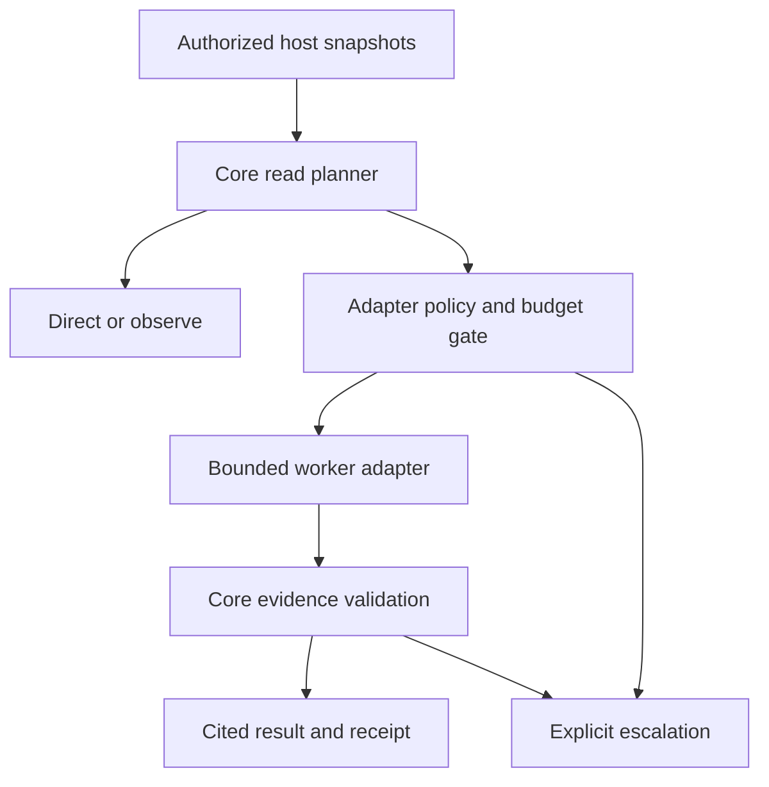

# ADR 520: Bounded context delegation in Ruflo core

Status: Proposed, implemented as an opt in core protocol
Date: 2026-11-01

## Problem and decision

Large analysis reads can put an entire corpus into the coordinating model even when the task only needs a small, cited result. Add a provider neutral core protocol that routes eligible analysis to a bounded worker and verifies the returned source evidence. This adopts the architectural concept behind [Spotify Shunt](https://github.com/spotify/portal-ai-plugins/tree/main/plugins/shunt), with independent implementation and no Portal dependency or copied upstream source.

Inputs are trusted host metadata, already authorized source snapshots, a question and an explicitly supplied adapter. Outputs are a direct route, a verified cited result with a receipt, or an escalation. The host owns source access, model selection, provider authorization, budgets and tool isolation. No source acquisition or model invocation happens implicitly.

Business hypothesis: preserving coordinator context can lower expensive model input and compaction pressure. Extra worker inference can negate the benefit. The deterministic benchmark proves protocol behavior and byte movement; live economic and semantic quality evidence is still required.

## Constraints and invariants

1. Default `legacy` preserves direct reads. `observe` reports eligibility and invokes neither authorization nor a worker. `enforce` enables delegation only for hosts that explicitly call this API with an adapter. It does not install or enforce host tool interception.
2. Only analysis is eligible. Edits, debugging, architectural judgments, targeted reads and nested workers remain direct. A worker request has depth one and an empty tools contract.
3. Default thresholds are 14,000 source bytes minimum, 120,000 serialized request bytes maximum, 16 files, 8,000 complete coordinator result bytes, 32 findings and a 30 second deadline. Serialized JSON escaping and wrapper bytes count toward the input maximum. The caller can configure positive finite integer limits; deadlines cannot exceed Node's timer range.
4. Snapshot identifiers are unique relative paths. The core never opens paths. The host must authorize and bound filesystem access, handle symlinks and regular files, and filter secrets before constructing snapshots. These identifiers alone are not filesystem authorization.
5. Snapshot copies and worker requests are immutable. Each source is SHA256 bound. Evidence must name a supplied snapshot and exactly match a nonempty line span from that snapshot.
6. Quotes establish provenance, not semantic correctness. Findings and quoted source remain untrusted data. They never authorize subsequent tools.
7. Authorization must return exactly true before one invocation. No retries, recursive dispatch, automatic writes, raw corpus fallback or exception text leakage. Timeout and caller cancellation bound the caller visible operation and signal the adapter. The adapter must stop its own remote operation and release reservations; an ignored AbortSignal cannot be forcibly terminated by this provider neutral service.
8. Receipts contain identities, byte accounting, duration and optional adapter supplied usage. Unknown usage remains absent. No prices, token counts or savings are inferred from bytes. There is no persistence or raw prompt logging in the core.
9. Invalid caller metadata or configuration may throw before dispatch. Worker, authorization, timeout and evidence failures return `escalate`; the host then chooses an authorized targeted read or a separately budgeted escalation.

## Architecture and integration

`services/context-delegation.ts` owns planning, immutable snapshots, deadline/cancellation, response validation and receipts. It is exported from the CLI core public index. `commands/context-plan.ts` adds `ruflo hooks context-plan`, a metadata only entry registered in the existing hooks registry.

Host adapter integration requirements for a later provider enabled change:

1. Authorize source acquisition under the host's existing filesystem capability before snapshots are created.
2. Select a model through the existing router without increasing the caller's safety envelope. Enforce destination restrictions, data classification and zero worker tools or MCP capabilities in the actual provider request. `tools: []` in this protocol is a contract, not a sandbox.
3. For autonomous Claude subprocess adapters, reserve through `getGlobalAiBudget().reserve` before launch, release in all terminal paths and record quota errors. Use policy runtime authorization and capability envelope reduction where applicable. Do not replace either gate with a permissive boolean stub.
4. Bound response reads at the transport before buffering. Core validation rejects oversized strings after receipt, but cannot cap memory inside an external adapter.
5. Stop remote inference on cancellation and apply no writes from findings. Treat usage as trusted adapter telemetry, not cryptographic billing proof.

The existing headless analyzer is deliberately not reused: it stages plugins, builds context from globs and logs prompts and results. Those are broader capabilities than this narrow analysis protocol needs.

## Alternatives

| Approach | Delivery cost | Runtime implications | Main risk | Decision |
|---|---|---|---|---|
| Install Shunt unchanged | Low with Portal already deployed | Requires Portal and AiKA | New service dependency and host specific hooks | Decline for core |
| Reuse broad headless analyzer | Medium | Existing launch fuse, plugins and context assembly | Unnecessary tools and raw prompt logging | Decline for this boundary |
| Core protocol plus governed adapter seam | Medium | Explicit extra worker cost; measurable context reduction | Adapter enforcement and semantic fidelity still need live validation | Select |
| Automatically intercept every large read now | High | Could reduce context broadly | Incorrect routing or blocked exact source access | Defer |

## Evidence and rollout gates

The [benchmark report](../../../docs/benchmarks/context-delegation.md) links the pinned corpus, raw paired samples, source hash manifest and verifier. Thirty extractive cases run ten times each compare a reconstructed full source transport reference with the candidate protocol. This is not a historical production session or live model benchmark.

Focused tests cover routing, malformed metadata, forged/stale citations, bounds, cancellation, redaction and the hook entry. A dedicated CI workflow runs focused strict type checking, tests, committed evidence verification and an independent benchmark replay.

Rollout: merge the default preserving protocol first. A later provider adapter PR must demonstrate at least 30% lower total billed inference cost, no critical factual omissions on a held out corpus, and no more than 20% higher median end to end latency, including retries and escalation. The required host and provider receipts must be recorded. Thresholds are proposed acceptance targets, not measured outcomes.

Rollback: keep hosts in `legacy` or remove the opt in adapter call. No migrations, credentials, daemon schedule, marketplace entry or release version change is needed.

## Requirement to evidence trace

| Requirement | Evidence |
|---|---|
| Existing behavior preserved by default | Legacy and observe tests, zero worker calls |
| Bounded analysis delegation | Planner boundaries, input/output/file/finding limits |
| No policy bypass | Mandatory adapter authorization, denial and late authorization tests |
| Source integrity | SHA256, exact span tests, forgery and stale snapshot rejection |
| Finite caller wait | Timeout and preexisting/inflight cancellation tests |
| Reviewable performance claims | Paired raw samples, full boundary accounting, source manifest verifier |
| Public integration | Index exports and registered `hooks context-plan` tests |
| No implicit model spend | No provider, filesystem, network or process implementation |
