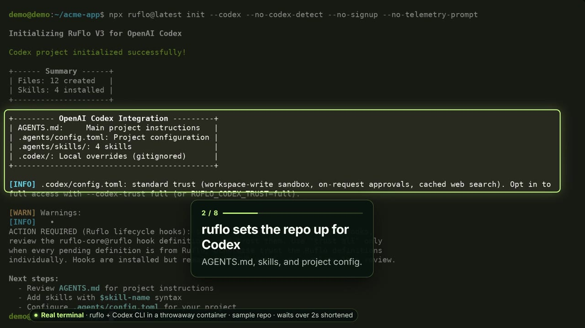
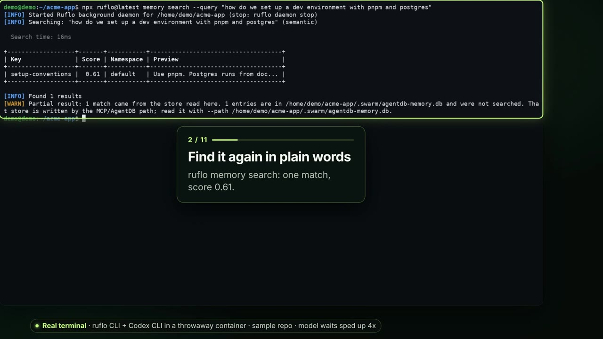
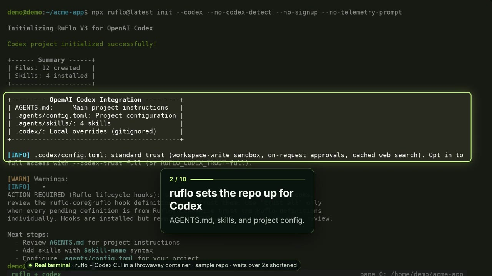
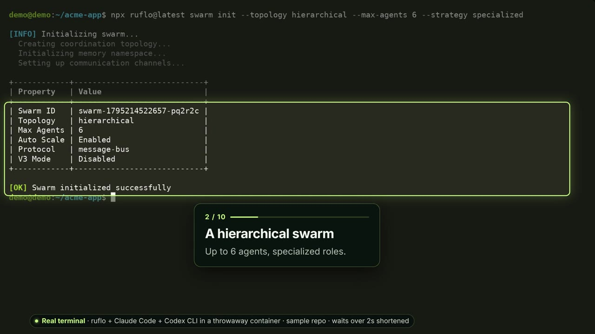
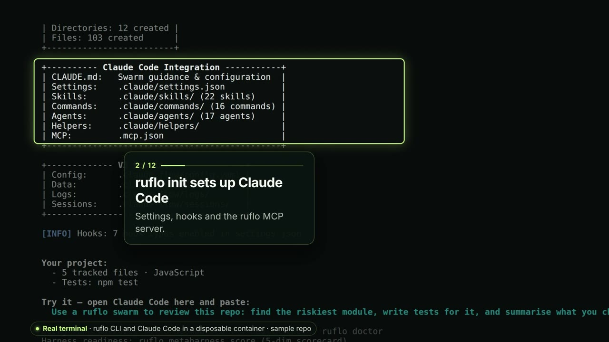

# ruflo video demos

Narrated walkthroughs of the real `ruflo` CLI, used with Codex CLI and Claude Code.

Every frame is a real terminal session:
- Each session was recorded with `asciinema` in a throwaway Docker container on a sample repo (`demo@demo:~/acme-app`).
- Every line on screen came from a command that actually ran. Nothing was typed in by hand or edited.
- Where waits were sped up or trimmed, an on-screen badge says so.

| | Video | Length | What it shows |
|---|---|---|---|
| [](codex-reviewer.mp4) | [**Codex as reviewer**](codex-reviewer.mp4) | 2:18 | A ruflo issue is claimed, then handed to Codex for review. Codex runs a real `codex review --base main` and catches a bug where stacked discounts make a cart total negative. The decision is stored in ruflo memory and read back. |
| [](codex-drafts.mp4) | [**Codex drafts with team memory**](codex-drafts.mp4) | 2:38 | A team convention is saved with `ruflo memory store`. Codex checks ruflo memory before drafting a setup script, you review the draft, and Codex writes the file only after you say "looks good". |
| [](codex-parallel-worktrees.mp4) | [**Two issues in parallel worktrees**](codex-parallel-worktrees.mp4) | 2:04 | For each issue, a start script claims it with `ruflo issues claim`, creates a git worktree, runs setup, and launches `codex exec`. Two Codex runs work side by side in tmux, each commits its own fix, and `ruflo issues board` shows both issues claimed. |
| [](cc-console-swarm.mp4) | [**Set up a swarm for Claude Code and Codex**](cc-console-swarm.mp4) | 2:17 | `ruflo init --dual` and a hierarchical `swarm init`, then three agents are spawned (planner, builder, codex-reviewer) and a shared release plan is stored in memory. ruflo is wired into Claude Code and Codex, and each shows the server connected. `ruflo mcp tools` lists the swarm and agent tools, followed by `swarm status` and a memory search. |
| [](cc-safety-approvals.mp4) | [**Safety and approvals in Claude Code**](cc-safety-approvals.mp4) | 2:48 | `ruflo init` writes the Claude Code permission rules, and `ruflo hooks pre-command` rates `rm -rf build` as CRITICAL. In manual mode Claude Code asks before every command. You approve `npm test` and refuse `rm -rf build`, and `build/` is still there afterwards. |

## Commands shown

**Codex as reviewer**
```bash
npx ruflo@latest init --codex
codex mcp add ruflo -- npx -y ruflo@latest mcp start
codex mcp list
npx ruflo@latest issues claim 42 --agent coder:coder-1
npx ruflo@latest issues handoff 42 --to agent:reviewer:codex -r "Review the coupon-code change"
codex review --base main
npx ruflo@latest issues handoff 42 --to user:1:demo-dev -r "Codex review: changes requested"
npx ruflo@latest memory store -n reviews -k coupon-codes --value "..."
npx ruflo@latest memory retrieve -k coupon-codes -n reviews
```

**Codex drafts with team memory**
```bash
npx ruflo@latest memory store --key setup-conventions --value "Use pnpm. Postgres runs from docker compose (service db). Migrations: pnpm migrate."
npx ruflo@latest memory search --query "how do we set up a dev environment with pnpm and postgres"
codex mcp add ruflo -- npx -y ruflo@latest mcp start --tools memory
codex            # /mcp verbose → ruflo connected, 26 tools
```

**Two issues in parallel worktrees**
```bash
npx ruflo@latest init --codex
codex mcp list
scripts/start-issue.sh 12   # ruflo issues claim 12 → git worktree add → setup → codex exec
scripts/start-issue.sh 13   # same, in a second tmux pane, running at the same time
git worktree list
npx ruflo@latest issues board
```

**Set up a swarm for Claude Code and Codex**
```bash
npx ruflo@latest init --dual --minimal
npx ruflo@latest swarm init --topology hierarchical --max-agents 6 --strategy specialized
npx ruflo@latest agent spawn -t architect --name planner   # also: coder/builder, reviewer/codex-reviewer
npx ruflo@latest agent list
npx ruflo@latest memory store --key release-plan --value "Ship v0.2: ..."
claude mcp add ruflo -- npx -y ruflo@latest mcp start && claude mcp list
codex mcp list && codex mcp get ruflo
npx ruflo@latest mcp tools
npx ruflo@latest swarm status
npx ruflo@latest memory search --query "who reviews the release"
```

**Safety and approvals in Claude Code**
```bash
npx ruflo@latest init
cat .claude/settings.json            # permission allow/deny rules
npx ruflo@latest hooks pre-command -c "rm -rf build"   # → risk: CRITICAL
claude                              # trust + MCP approval, shift+tab to manual mode
# prompt: "Run the tests, then delete the build folder"  → Yes, Yes, No
ls build/                           # still there
```

## Known limits shown honestly in the videos

- **Codex sandbox:** Codex's bubblewrap sandbox cannot start inside Docker, so these sessions run Codex with `sandbox_mode = "danger-full-access"` in a throwaway container. The flag is visible on screen.
- **MCP tools through the model gateway:** the sessions route through the Cognitum gateway. Codex lists ruflo's MCP tools there but isn't offered them as callable tools, so it reaches ruflo through the `ruflo` CLI instead. The narration says so.

These files are not part of any npm package. The published `files` allowlists don't include `video-demos/`.
